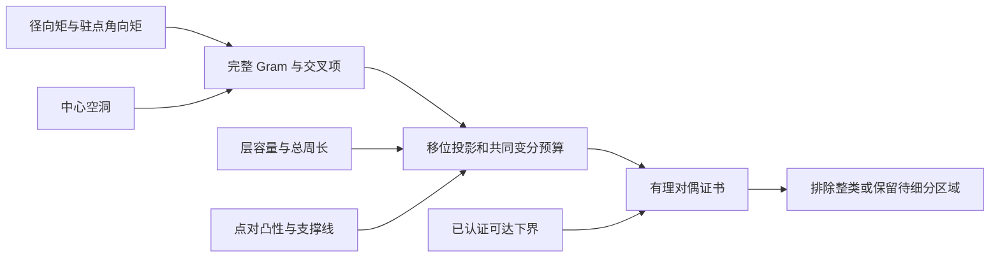

# 联合变分框架：矩—层—点距共享同一能量

研究资料与项目发起：**蒋丰灿（Fengcan Jiang）**；推导及精确程序包含 OpenAI Codex 协作。2026-10-31。承接a7f17cace1d91dfe4ceee512018d4aa6f5f96eee。

本轮构建一个可逐步增广的共同预算：完整Gram保留已测矩与周长测试的相关性，点对全局支撑线把层边长接入能量，Hilbert空间完成平方消去未知的剩余能量。新方法已实现并给出百点条件排除，不仅是研究提案。

## 1. 框架主不等式

沿用δ=log(U_n/Δ)，H为完整Gram，m为实际n倍测量，c为周长测试与各测试的交叉项。写

~~~math
J=m^TH^{-1}m,\quad p=c^TH^{-1}m,\quad
h=H_f-c^TH^{-1}c.
~~~

对任何已认证P(d)≥α−βd的全局支撑线，有

~~~math
\boxed{\delta\ge A+C+J+\alpha(n-2K)
-2\pi\beta(V_0-p/4)-\pi^2\beta^2h/16.}
~~~

A只能使用已证正交的其他能量，C只能使用未被层循环边占用的点对资源。V₀是明确的层容量与平滑误差项。[主证明](FRAMEWORK.md)逐项解释条件、尺度和公式；[证书构造](DUAL_CERTIFICATES.md)给出支撑线、径向和中心空洞自动适配器、整盒对偶及防重复计数账本。

## 2. 已经得到的百点联合约束

记P_k=Σz_i^k。对百点全局最优者：

- 若不同半径数K≤4，则|P₂|<27/10，并有更强的P₂、P₃必要椭圆。
- 若再有全部|z_i|²≥8/99，则|P₂|<9/4；这是由对应平滑中心空洞接入同一矩阵得到的。

第一类在角向能量≥151/200时，新总下端>0.8302030701153405，超过已证上端0.827847658522。所比较的分开能量松弛仍可通过，程序以独立上积分认证这一差别。

[百点证明与完整比较](N100_CERTIFICATES.md) · [有理验收](joint_class_verification.json)。这些是条件必要式；未证明百点至少五层，未认证某个数值构型全局最优，也未完成八点锐界。

## 3. 下一步如何使用

已有径向矩、角向矩和空洞测量可逐步加入完整Gram；同一测试方向加入后对偶最优值不会下降。对剩余构型盒选择固定有理对偶向量，整个盒的下端超过可达上端即排除。不同矩区间、层人口或短边标签可以成为下一次细分变量。

本轮已提供这一验证核心及四套精确入口。任意偏心空洞的周长交叉项、宽环带版容量适配和全部剩余盒的穷尽覆盖仍是后续工作。框架不会把这些尚未完成的接口登记为已解决结论。

## 复现

~~~bash
python -B -S -O joint-variational/verify_all.py
~~~

在仓库或[离线包](mordell-joint-variational-2026-10-31.zip)解压根目录运行。仅需Python标准库，重放此前16个与本轮4个入口，固定所有必需字节，并保留-O下的检查。

[统一报告](verification_report.json) · [输入清单](source_manifest.json) · [来源与范围](PROVENANCE.json)。经典Gram、Schur和凸对偶不作发明或全球优先权声明；一个研究代理完成本轮推导与核验，没有独立代理或外部同行评审。
