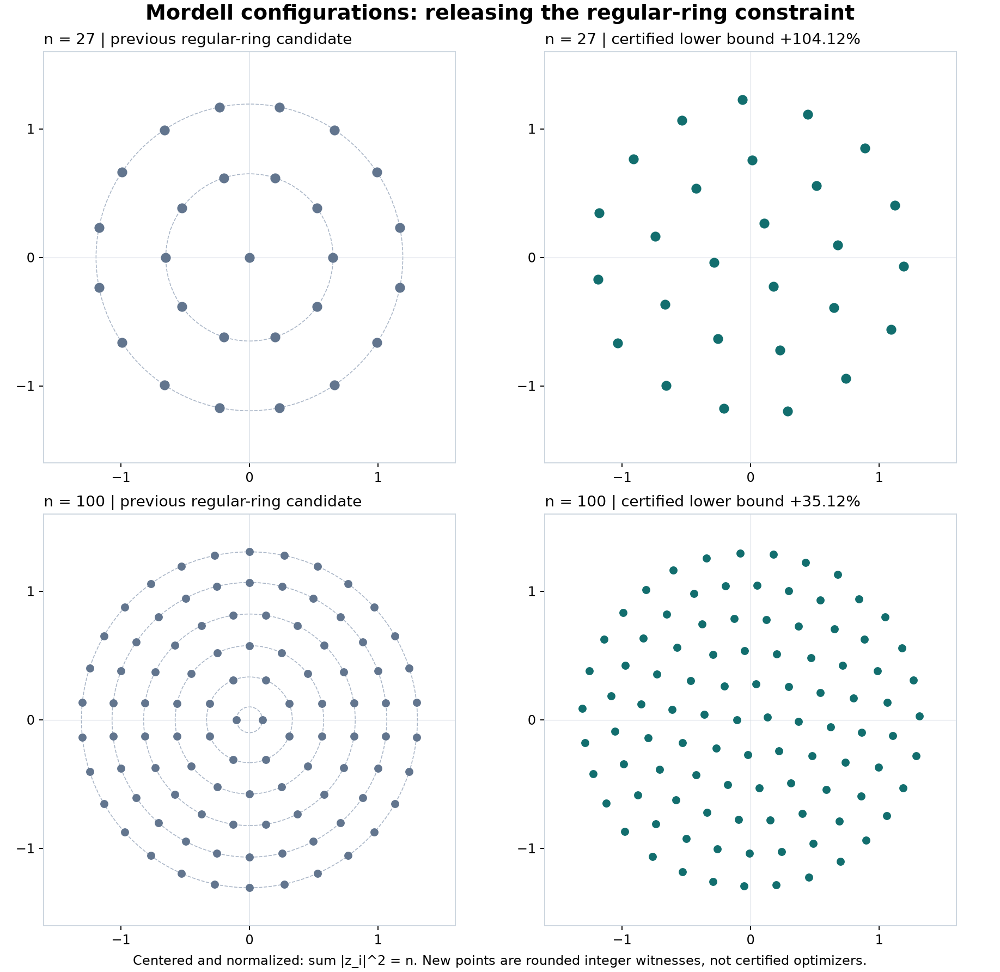

# 放开规则环之后：整数坐标下界及对全局最优层数的反馈

蒋丰灿（Fengcan Jiang）研究项目；OpenAI Codex 协作。2026-10-29。比较基线固定为提交 f0ef6c7048fa3ddcf0181972c7c8fe3994c6030d 的全部已存可达下界。

## 1. 探索与接受分开

[探索程序](explore.py)在平面上允许每个点自由移动，以

~~~math
H(z)=\frac{n-1}{2}\sum_i|z_i|^2-\log\Delta_n(z)
~~~

为目标，运行有预算的浮点 L-BFGS。种子包括上一轮规则环、固定随机种子的扰动，以及前一个点数的候选加一个点；每个种子至多1200次更新。没有预设每环等角、精确层数、中心点或反射对称。只执行了这些种子，没有穷尽全部局部极值。

每个被选结果经中心化与尺度归一后，乘10^8并取最近整数，保存为[整数坐标](integer_witnesses.json)。浮点梯度小、线搜索停止、迭代预算耗尽等信息仅属于探索记录，不承担驻点或全局最优结论。

接受程序只读取整数点 u_i=(a_i,b_i)，设

~~~math
D=n\sum_i|u_i|^2-\left|\sum_i u_i\right|^2,\qquad
z_i=\frac{nu_i-\sum_j u_j}{\sqrt D}.
~~~

点互异保证 D>0；Σz_i=0、Σ|z_i|²=n，且精确可达值为

~~~math
F(u)=\frac{n^{2N}\prod_{i<j}|u_i-u_j|^2}{D^N}\in\mathbb Q_{>0}.
~~~

全部点距、中心化、乘积和与旧下界的比较都重新使用整数或 Fraction 计算。证明接受流程不需要 NumPy、优化器、网络或浮点数。

## 2. 相对完整既有包络的91项严格改善

在10≤n≤100的91个点数，整数见证**全部严格超过此前完整包络**。基线包含旧多环、方格和三角格、保存整数构型、矩平均、此前全部正负相位、65个旧上升见证、内环收缩以及上一轮人口—半径优化的实际值和存在性代理值。旧条目的哈希在重算时核对，没有只选一个较弱环构造来比较。

|n|相对旧完整下界的严格增益下端|log(U_n/M_n) 的上端|
|---|---:|---:|
|13|76.81%|0.240541746396|
|17|6.93%|0.315328806095|
|27|104.12%|0.310400705740|
|40|53.60%|0.362652018001|
|80|13.26%|0.634904092101|
|100|35.12%|0.827847658522|

百分数向下取整；缺额上端向上取整。10、11、12点的改善仅约10^−12量级的对数增益，虽然严格但很小。91项改善并非91项同样显著的突破；以上百分数也不是对未知 M_n 的相对误差。

图仅展示实际坐标。右图不是已认证的最优构型，舍入后的半径差也不能用来推断真正最优者的精确层数或对称性。

## 3. 更紧的全局预算，反过来给更强必要层数

任意全局最优者 z* 满足

~~~math
\delta(z^*)=\log(U_n/M_n)\le\log(U_n/F(u)).
~~~

把该预算送入[此前已经证明的通用层数界](../radial-angular/RADIAL_LAYERS.md)，得到

~~~math
\boxed{K_n\ge3\quad(39\le n\le42),\qquad
K_n\ge4\quad(80\le n\le85).}
~~~

这些约束适用于**任意角度的全局最大构型**，不要求属于搜索使用的构型族。相同层数接口和相同平滑参数集合 {1,99/100} 下，此前完整下界在这两组点数仅分别给至少2层、3层。13、15点的接口输出也由1升至2，但“两层”已可由既有单环不稳定性得到，不把它计作新的结构发现。

本次对全部91个点数重新计算了必要层数；100点仍至少四层，没有提高成五层。一般 n 的 K>3√n/22 及渐近下端101/250保持上一轮结论，本次没有提高这两个通用常数。

[完整逐项报告](witness_verification.json)保存每个点数最后被排除的 K、平滑参数、有理缺额下界，以及严格较小的全局预算，避免只凭显示小数判定矛盾。

## 4. 避免对巨大整数乘积展开高次对数

精确乘积的分子分母可以很大。新的[对数接受工具](exact_bounds.py)把任意正有理数 q 写为 2^e r，1≤r<2，再把 r 夹在相邻的64位二进分数之间。利用 log 的单调性与已有有理 atanh 级数，得到严格上下端。所有取整通过整数除法完成，未把巨大乘积先转成浮点近似。

这让整张下界表都能返回层数方法，而不是只计算两个示例。其证明只有幂次缩放、单调性和级数余项，不声称对数算法框架的原创性。

## 5. 当前最值得继续的方向

已有相位余量很小而自由点移动仍显著改善，说明“各环始终正规”的约束会丢失实际提升空间。下一步可以：

1. 用新人口障碍和点距—半径差约束，在径向带、角差及整数人口联合区域中提前排除不可能的最大点。
2. 把满足人口平衡时的稀疏剩余多项式作为有限分支，与混合矩能量及完整稳定性矩阵联合。
3. 对高质量整数见证构造更精细的局部证书或严格分支上界。近驻点和局部最大仍不能替代全局覆盖。

目前没有证明一般 n 的最优点阵、唯一构型、真实精确层数、八点完整锐值或精确线性渐近常数 γ。这里完成的是可达下界、普遍必要条件与有限排除接口。
